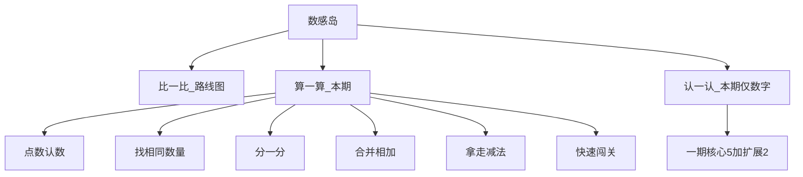


# 数感岛 · 10 以内算数互动网页（完整精简需求 / PRD）

> **状态**：已确认 · 落盘于 docs/plans/数感岛-一期-design.md`n`n> 素材：计数物 PNG 由用户后续整理提供；当前用 emoji/CSS 占位，文件名约定见 §6。  
> **来源**：`数感算一算设计` 方案 + 用户合并定稿稿；待确认项已给**默认决策**。

---

## 0. 一句话与范围

| 项        | 内容                                                  |
| -------- | --------------------------------------------------- |
| 定位       | 用图片、动画、点击/拖拽，帮 **4～7 岁**建立 **10 以内**数感              |
| **本期点亮** | **算一算**全线六玩法 + **认一认·数字**分支                         |
| **不本期**  | 比一比；认一认非数字；听音/描红/儿歌等                                |
| 底线       | 仅点击 + 拖拽；错题友好；**无**红色大叉、倒计时、扣分、排行榜                  |
| 数字       | **1～10** 进一期；**0** 放二期                              |
| 素材       | **极简**：数字/算式/盘子/篮子/台阶/圆点用 **代码/CSS**；图片只需苹果等少量通用计数物 |

进度键：

- 算一算：`kiddo-playlearn:number:v1`
- 认一认：`kiddo-playlearn:number:recognize:v1`
- 与方向关 `direction-game:*` 隔离

---

## 1. 目标与痛点

- 数字与实物对应不稳，10 以内加减易错。
- 加数顺序一换就错，不理解交换。
- **6↔9、2↔5、3↔8** 等数字符号易混。
- 分合、加减互逆、相邻数、比多少没有串成关系。
- 辅导时怕眼神、爱哭 → 需要低压力、敢再试。

设计不以「刷题」为目标，而以下面 **四大能力柱** 为准绳；所有玩法必须能说清「练的是哪一柱」。

---

## 1.5 四大能力柱（设计强化主轴）

### 柱 A · 数字符号与形状辨识（形义对应）

**能力**：看到数字「5」，能瞬间认出字形，并与「五」的意义挂钩（不是只会唱数）。

**一期怎么练（强化点）**：

| 手段 | 落在哪 | 设计要求 |
|------|--------|----------|
| **大号字形曝光** | 认一认所有选数界面；算一算选数字钮 | 候选数字按钮 **超大圆角字形**（代码绘），答对瞬间 **放大闪光 1 次**，强化字形记忆 |
| **数字来报到（轻量升一期）** | 认一认第 0/热身关或并入「数一数选数字」开场 | 屏幕中央巨大 `N`，点一下：字形弹跳闪光 + 旁侧弹出 N 个苹果；建立「字形→数量」第一印象。原「二期数字来报到」**收一版进一期热身**（不做拟人角色） |
| **易混对照弱提示** | 连续错 2 次时 | 若目标是 6/9 等，弱提示只缩成易混对的 2 选 1，并短暂并排显示两个大字形（仍无大红叉） |
| **易混专题** | 谁长得不一样 | **仍二期**；一期用上面弱提示打底 |

**验收**：孩子能稳定点对大数字钮；开场点过「大 5」后，同局选 5 正确率更高（设计意图，不做复杂统计）。

---

### 柱 B · 点数与数量匹配（数量对应）

**能力**：突破机械唱「1、2、3…」；**看到数字就能拿出对应数量物品**；看到一堆也能选出数字。

**双向都要练**：

| 手段 | 落在哪 | 设计要求 |
|------|--------|----------|
| **点满才解锁** | 算一算·点数认数；认一认·数一数选数字 | 必须点亮每一个物体（弹跳+可播报数字），禁止未点数就蒙答案 |
| **符号→取物** | 认一认·按数取物（核心） | 中间只显示大数字；拖/点苹果进篮；**数量必须等于 N** 才过；多了可拖回，少了轻声「再拿一点」 |
| **种类干扰** | 找相同数量 | 同种类不同数量的干扰组，逼孩子比「个数」不是比「长得像」 |
| **先执行再求剩** | 拿走减法 | 先按语音拿走 k 个（操作数量），再选剩余（数量结果） |

**验收**：按数取物能独立完成 1～10；点数关不能跳过点击直接选数。

---

### 柱 C · 数字顺序与递增递减（序数概念）

**能力**：理解 1～10 的前后邻居，为加减与数轴打基础（+1 / −1 就是邻居）。

| 手段 | 落在哪 | 设计要求 |
|------|--------|----------|
| **数字邻居（升为一期核心，不再仅「扩展」）** | 认一认 | 问「5 的邻居是谁」；可点 4 与 6；画面底部常驻 **1～10 小台阶数轴**（CSS），当前数高亮，邻居闪一下 |
| **合并/拿走与邻居挂钩（轻提示）** | 算一算·合并 / 拿走 | 当题目是 `n+1` 或 `n-1` 时，答对后短句：「就是 5 的后一个 / 前一个哦」，并在小数轴上跳一格 |
| **比多少铺垫序与差** | 认一认·比多少 | 「7 比 5 多几个」→ 数轴上从 5 跳到 7 数格子（可选短动画） |
| **排队补缺** | 谁不见了 | **二期**；一期用邻居+数轴打底 |

**验收**：数字邻居关可玩；`n±1` 题答对有邻居话术；数轴组件可复用。

---

### 柱 D · 10 以内组成与分合（代数萌芽）

**能力**：一个数能分成两个部分（如 5=2+3）；这是 10 以内加减的底层逻辑；交换与互逆要看得见。

| 手段 | 落在哪 | 设计要求 |
|------|--------|----------|
| **主动拆** | 算一算·分一分；认一认·分一分·组成 | 拖成两堆；底部 **拆法卡片**；鼓励至少再找一种；`2+3` 与 `3+2` 都记 |
| **合与拆对照** | 合并相加答对后「还能怎么分」 | 演示 2～3 种拆法，把「合出来的总数」立刻变成「可拆的总数」 |
| **加减一家人** | 认一认核心 | 同屏 `2+3` `3+2` `5-2` `5-3`；点哪个演哪个（合/拆/拿走），建立互逆 |
| **交换成对** | 合并相加 | `3+5` 下一题强制 `5+3` |

**验收**：分一分能提交多种拆法；加加减减一家人四种算式都能点播演示。

---

### 玩法 × 能力柱对照（一期）

| 玩法 | A 形义 | B 数量 | C 序数 | D 分合 |
|------|:------:|:------:|:------:|:------:|
| 算·点数认数 | △ 选数字钮 | ● | | |
| 算·找相同数量 | | ● | | |
| 算·分一分 | △ 显示 a+b | ● | | ● |
| 算·合并相加 | △ 算式 | ● | △ n±1 | ● 答对后拆 |
| 算·拿走减法 | △ 算式 | ● | △ n±1 | △ 互逆铺垫 |
| 算·快速闯关 | 综合 | 综合 | 综合 | 综合 |
| 认·数字来报到(热身) | ● | △ | | |
| 认·数一数选数字 | ● | ● | | |
| 认·按数取物 | ● | ● | | |
| 认·分一分组成 | △ | ● | | ● |
| 认·加加减减一家人 | △ | ● | | ● |
| 认·比多少 | △ | ● | ● | |
| 认·数字邻居 | ● | | ● | |
| 认·大闯关 | 综合 | 综合 | 综合 | 综合 |

● 主练　△ 顺带强化

---

## 2. 产品结构：数感岛

首页进入 **数感岛** → 三条线：

| 线路      | 本期状态             |
| ------- | ---------------- |
| 比一比     | 路线图，入口可灰显或「即将开放」 |
| **算一算** | **本期开发**         |
| **认一认** | **本期先做「数字」分支**   |

认一认·数字重点：**数与数之间的加减关系与联系**（不是听音、不是描红）。

---

## 3. 通用交互与纠错

- **操作**：点击、拖拽、选数字大按钮。
- **反馈**：点击弹跳、移入/移出、合并汇聚、淡出、答对闪光、贴纸飘落。
- **答对**：星星、音效、庆祝短动画。
- **答错**：不判失败；**不高亮错误答案**；引导「再数一遍 / 再分一次」。
- **连续错 2 次**：弱提示 + 候选缩到 **2 选 1**。
- **语音**：题干、数字名可朗读；静音可关；**玩法不依赖听音**。
- **分合多解**：任意 `a+b=N`（默认 a,b≥1）都对；`2+3` 与 `3+2` 都算。
- **闯关**：5 题一组；不扣分、无倒计时；错了重试当前题；通关贴纸。
- **摆放**：物体分散，避免堆叠遮挡。

---

## 4. 算一算 · 本期六玩法

**解锁顺序**：  
`点数认数 → 找相同数量 → 分一分 → 合并相加 → 拿走减法 → 快速闯关`

| #   | 玩法    | 孩子做什么                     | 练什么        |
| --- | ----- | ------------------------- | ---------- |
| 1   | 点数认数  | 随机计数物出现，点一下弹跳并计数，数完选数字    | 一一对应、基数    |
| 2   | 找相同数量 | 左一组，右多组候选，选数量相同的一组        | 不靠位置/种类比多少 |
| 3   | 分一分   | 一堆拖成两堆，显示如 `5=2+3`，鼓励多种分法 | 分合、多解、交换   |
| 4   | 合并相加  | 左右两堆推入中间合并，问总数如 `3+7=?`   | 加法、合起来     |
| 5   | 拿走减法  | 点击若干「拿走」淡出，算剩余如 `6-2=?`   | 减法、还剩几个    |
| 6   | 快速闯关  | 从玩法 1～5 题型池抽 5 题          | 综合巩固、成就感   |

### 4.1 一期并入的小升级（已定）

1. **点数认数**：必须点满所有物体才解锁数字钮（防蒙）。
2. **分一分**：底部「已找到拆法」卡片；重复分法温柔提示；鼓励再找一种。
3. **合并相加**：刚做 `3+5`，下一题自动 `5+3`；语音「只是换了边，还是这些」。
4. **找相同**：干扰项含「同种类但数量不同」。
5. **拿走减法**：先语音「请拿走 2 个」→ 孩子点掉 2 个 → 再问还剩几。

### 4.2 合并相加 · 演示（已定默认）

- **默认 A**：左右入场 → 合并汇聚 → 选题。
- **答对后按钮 B**：「看看 N 还能怎么分」→ 自动演示 **2～3 种**拆法短动画（如 10→1+9、2+8、5+5）；可跳过。
- **C**（答对后直接进一小段分一分）→ **二期**。

### 4.3 算一算二期候选（不开发）

十格阵速认、缺数填空、找朋友配对、生活场景、气球算式、听听有几下、遮一遮、故事一小句、合并后强制进分一分。

---

## 5. 认一认·数字 · 本期与扩展

**画面原则**：大数字 + 少量通用计数物；数字/算式/盘子/篮子/台阶/圈/遮罩/圆点全部 **代码渲染**。

### 5.1 一期必做（对齐四大能力柱）

| # | 玩法 | 孩子做什么 | 主练柱 | 阶段 |
|---|------|------------|--------|------|
| 1 | **数字来报到（轻量热身）** | 巨大数字 N，点一下字形弹跳闪光 + 旁出 N 个苹果 | **A 形义**（带一点 B） | **一期热身** |
| 2 | 数一数选数字 | N 个苹果点满再选大数字钮 | **B→A** | **一期核心** |
| 3 | 按数取物 | 大数字 → 拖满 N 个进篮 | **A→B** | **一期核心** |
| 6 | 分一分·组成 | 拖成两堆，拆法卡片，多解 | **D** | **一期核心** |
| 7 | 加加减减一家人 | 同屏四种算式，点哪个演哪个 | **D** 互逆 | **一期核心** |
| 9 | **数字邻居** | 「5 的邻居」，小数轴高亮跳格 | **C 序数** | **一期核心**（由扩展升格） |
| 8 | 比多少 | 「7 比 5 多几个」，可辅以数轴跳格 | **C + B** | **一期扩展 · 优先加** |
| 10 | 认一认大闯关 | 5 题混合抽自以上题型 | 综合四柱 | **一期核心** |

**认一认一期解锁顺序**：  
`数字来报到(热身) → 数一数选数字 → 按数取物 → 数字邻居 → 分一分·组成 → 加加减减一家人 → 比多少 → 大闯关`

> 序数关提前到分合之前：先稳住「前后邻居」，再进分合与加减互逆，更符合幼小衔接认知顺序。

### 5.2 二期（认一认·数字，不本期开发）

| # | 玩法 | 说明 | 主练柱 |
|---|------|------|--------|
| 4 | 谁长得不一样 | 6/9、2/5、3/8 易混专题 | A |
| 5 | 数字排队 + 谁不见了 | 顺序与补缺 | C |
| — | 其它升级 | 凑十、数字分家、小楼梯、翻翻乐、影子猜猜、大富翁等 | 综合 |

### 5.3 认一认明确不做

听音辨数、儿歌、描红、手指描线、数字拟人角色图、大场景图、超过 10、倒计时、扣分、排行榜。

---

## 6. 素材与视觉

### 6.1 共用风格（中文绘画提示词前缀）

> 儿童教育小游戏素材，二维扁平插画，圆润柔和造型，可爱亲切，风格与「小兔闯关」App 一致，轮廓清晰，居中构图，透明背景（或浅奶油色底），无文字、无水印，手机端高对比度，单个物体，光线均匀，不要 3D、不要写实照片、不要暗黑、不要恐怖。

### 6.2 算一算建议出图（少量）

| 文件                | 提示词（接在共用风格后）                 |
| ----------------- | ---------------------------- |
| `item_apple.png`  | 一只成熟红色苹果，简洁可爱，轻微高光           |
| `item_banana.png` | 一根弯弯黄色香蕉，卡通可爱                |
| `item_carrot.png` | 橙色胡萝卜，一点点绿叶                  |
| `item_bunny.png`  | 坐着的小兔子，圆润                    |
| `item_chick.png`  | 圆滚滚黄色小鸡                      |
| `item_bear.png`   | 坐着的小棕熊，可爱头身比                 |
| （可选）垫子            | 左右/中间椭圆垫可用 **CSS** 代替出图，能省则省 |

贴纸、算式符号、篮子轮廓：优先 CSS；过关贴纸可后补 1～2 张或用现有星星/emoji 占位。

### 6.3 认一认素材

- **原则上不新增图**；苹果为默认计数物；兔/鸡/熊可换皮复用算一算图。
- 数字、算式、篮子、盘子、台阶、圈、遮罩、圆点：**代码渲染**。
- 小兔庆祝：复用现有 `hero_*`。

### 6.4 动画

单 PNG + CSS：弹跳、汇聚、淡出、闪光、贴纸飘落。不做序列帧、不做复杂骨骼。

---

## 7. 技术落点（确认 PRD 后再实施）

- 路由：数感岛首页 → 算一算子地图 / 认一认·数字子地图 → 各玩法页。
- 复用方向关气质：大按钮、语音可选、温和纠错；会话状态可平行 `useNumberSession` / `useRecognizeSession`。
- 共用模块：分散摆盘、点击计数、拖拽分堆、数字钮、弱提示 2 选 1、贴纸奖励。
- **最小改动**；不改框架级依赖；进度 localStorage 分键。

---

## 8. 验收清单（一期）

**四大能力柱**

- [ ] **A 形义**：数字来报到热身；选数钮超大字形；答对闪光放大
- [ ] **B 数量**：点数须点满；按数取物数量 = N；找相同有同种异量干扰
- [ ] **C 序数**：数字邻居 + 小数轴；`n±1` 题有邻居话术
- [ ] **D 分合**：拆法卡片多解；合并后可看拆法；加加减减一家人可点播

**算一算**

- [ ] 六玩法可玩、按序解锁；快速闯关 5 题不扣分
- [ ] 五点小升级符合 §4.1；合并 A + 答对后 B
- [ ] 无大红叉 / 倒计时 / 扣分

**认一认·数字**

- [ ] §5.1 一期表内玩法可玩（热身 + 邻居升格 + 扩展比多少）
- [ ] 数字/容器代码绘；计数物苹果可换皮

**通用**

- [ ] 静音可关仍可玩；进度分键不覆盖方向关
- [ ] 手机竖屏主推；大触控区

---

## 9. 已定默认决策（原待确认项）

| 议题 | 默认 |
|------|------|
| 设计主轴 | **四大能力柱**（形义 / 数量 / 序数 / 分合） |
| 一期升级 5 条 | **全部进一期** |
| 合并演示 | **A + 答对后 B**；C 二期 |
| 数字来报到 | **轻量升一期热身** |
| 数字邻居 | **升一期核心** + CSS 小数轴 |
| 易混专题 / 排队补缺 | **二期**（一期仅弱提示） |
| 数字 0 | **二期** |
| 比一比 | **不本期** |
| 听音、描红 | **明确不做** |
| 素材 | **极简**；能 CSS 就不出图 |

---

## 10. 下一步

1. 你确认「按本 PRD 定稿」→ 状态改为已确认，落盘 `docs/plans/数感岛-一期-design.md`。
2. 你按 §6 生成苹果等 PNG（可先只出苹果跑通）。
3. 再开实施计划 / 开工写代码（writing-plans 或直接实现）。

