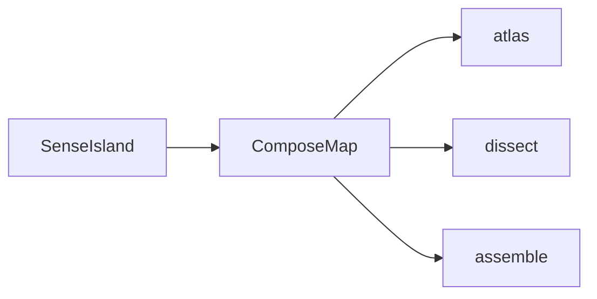

# 数感岛 · 拼图形（设计）

> **状态**：已实现（2026-10-16）  

> **关联**：[数感岛-认一认-颜色图形-design.md](./数感岛-认一认-颜色图形-design.md)、[数感岛-比一比-design.md](./数感岛-比一比-design.md)  
> **入口**：数感岛第四卡 → `/sense/compose`  
> **进度键**：`kiddo-playlearn:number:compose:v1`

---

## 0. 一句话与范围

| 项 | 内容 |
| --- | --- |
| 定位 | 帮 **4～7 岁**理解平面图形如何拆开、拼合，并练习旋转对齐 |
| **本期** | 图鉴 + 拆一拆 + 拼一拼；4 组关系各 1 样板 |
| **不做（首期）** | 镜像翻转、任意拖转角度、自由画板、立体、七巧板全套、必须先图鉴才能拆/拼 |
| 底线 | 无大红叉、倒计时、扣分；SenseChrome + 语音 + Celebrate |
| 实现路径 | 对齐比一比：`ComposeMap` + `ComposePlay` |

---

## 1. 已锁定决策

| 项 | 决定 |
| --- | --- |
| 玩法 | A 拆一拆 + B 拼一拼 + C 图鉴 |
| 地图 | 玩法三分区，三行全开 |
| 入口 | 数感岛独立卡，随时可进 |
| 旋转 | 选中后顺时针预设 45° / 90° / 180° |
| 吸附 | 松手距槽心 &lt; ~18% 边长；否则回池；角差 ≤ 8° |

---

## 2. 四组关系

| id | 大图 | 小块 |
| --- | --- | --- |
| `square2tri` | 正方形 | 2 个全等直角三角形（对角线） |
| `rect2tri` | 长方形 | 2 个全等直角三角形 |
| `square4` | 大正方形 | 4 个小正方形（2×2） |
| `eqTri4` | 等边三角形 | 4 个小等边三角形（中点连线） |

---

## 3. 地图与路由

```text
数感岛 → 拼图形
  [图鉴]     /sense/compose/atlas
  [拆一拆]   /sense/compose/dissect
  [拼一拼]   /sense/compose/assemble
```



---

## 4. 玩法

### 4.1 图鉴

- 4 卡滑完记星；中途退出不记通关
- 拆合动画 + 旋转预览（45/90/180）

### 4.2 拆一拆

- 4 题点选；首次错记错题休息；错 2 次弱提示

### 4.3 拼一拼

- 4 关拖块吸附；整关首次放错记 1 次错题；无镜像

---

## 5. 技术落点

| 文件 | 作用 |
| --- | --- |
| `src/data/sense/compose.ts` | pair / 槽位 / 拆题 |
| `src/data/sense/meta.ts` | `ComposeModeId` / `COMPOSE_MODES` |
| `src/composables/useSenseProgress.ts` | compose 轨 |
| `src/views/sense/ComposeMap.vue` | 地图 |
| `src/views/sense/ComposePlay.vue` | 三模式 |
| `src/router.ts` | 路由 |
| `src/views/sense/SenseIsland.vue` | 第四卡 |

---

## 6. 验收清单

- [x] 数感岛可见「拼图形」，随时可进
- [x] 地图三行：图鉴 / 拆一拆 / 拼一拼
- [x] 图鉴 4 卡翻完记星；中途退出不记
- [x] 拆一拆 4 题；易混干扰；错题休息计入首次错
- [x] 拼一拼可拖、转 45/90/180、吸附；4 关过关
- [x] 进度键独立，不影响其它轨

---

## 7. 明确不做

镜像、任意角度拖转、立体、七巧板全套、强制图鉴前置、改框架配置。
