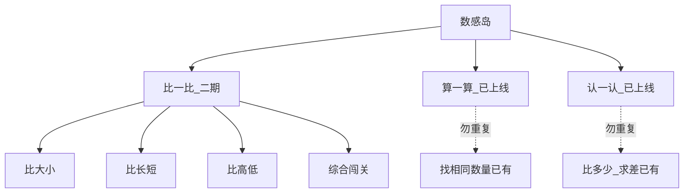

# 数感岛 · 比一比（二期设计）

> **状态**：二期首发已实现（地图可进）  
> **关联**：[数感岛-一期-design.md](./数感岛-一期-design.md)  
> **入口**：数感岛 ⚖️ → `/sense/compare`；进度键 `kiddo-playlearn:number:compare:v1`

---

## 0. 一句话与范围

| 项 | 内容 |
| --- | --- |
| 定位 | 用天平/并排互动，帮 **4～7 岁**建立**量的比较**（谁更大 / 更长 / 更高） |
| **本期（二期首发）** | 比大小、比长短、比高低 + 综合小闯关 |
| **不做（首版）** | 「多几个」求差；听音比；真实称重物理；认颜色（挂认一认扩展） |
| 底线 | 仅点击 + 拖拽；错题友好；**无**红色大叉、倒计时、扣分、排行榜 |
| 素材 | **极简**：棒/柱/大小差用 **CSS**；可复用现有计数物皮做「大小」道具 |

进度键（与算一算 / 认一认隔离）：

- `kiddo-playlearn:number:compare:v1`

---

## 1. 三条线边界（勿混）

早期约定：

| 线路 | 职责 |
| --- | --- |
| **比一比** | 感知比较：大/小、长/短、高/低 |
| 算一算 | 10 以内加减与分合 |
| 认一认 | 数字关系；颜色/图形扩展见 [数感岛-认一认-颜色图形-design.md](./数感岛-认一认-颜色图形-design.md) |

与已上线玩法对照：

| 玩法 | 所在线 | 孩子答什么 | 比一比是否重复 |
| --- | --- | --- | --- |
| **比一比**（本文） | 比一比 | 谁更大 / 更长 / 更高 / 是否一样 | — |
| 认一认·比多少 | 认一认 | 「7 比 5 **多几个**」→ 求差选数字 | **不搬进比一比** |
| 算一算·找相同数量 | 算一算 | 哪一组「一样多」 | **不搬进比一比** |

**能力柱**：主练感知序 / 量感（与一期柱 C 相邻，但对象是**实物属性**，不是数轴求差）。  
**与比多少分工**：比一比答「谁大 / 一样」；比多少答「多几个」。

---

## 2. 关卡结构（二期首发 3+1）

解锁顺序：**比大小 → 比长短 → 比高低 → 综合小闯关**（前一关通关再开下一关；闯关需前三关均通）。

### 2.1 比大小（入口关）

| 项 | 设计 |
| --- | --- |
| 题干 | 「哪个更大？」「选一样大的」 |
| 画面 | 两个（或两组）物体；可点选一侧，或拖到天平左右盘（呼应岛页 ⚖️） |
| 干扰 | 颜色/种类可不同，逼孩子比「大小」不比「好看」 |
| 答对 | 天平倾向 / 正确侧高亮闪光 |
| 答错 | 「再看一看哪个更大」，不叉掉 |
| 验收 | 肉眼可辨的大小差；错 2 次有弱提示（描边正确侧） |

### 2.2 比长短

| 项 | 设计 |
| --- | --- |
| 题干 | 「哪根更长？」「找一样长」 |
| 画面 | 两根棒 / 绳子 / 小路（**CSS 即可**） |
| 升级 | 三选一（两短一长），降低蒙对 |
| 验收 | 长度差足够明显；竖屏横条不挤成一团 |

### 2.3 比高低

| 项 | 设计 |
| --- | --- |
| 题干 | 「谁更高？」「谁更矮？」（矮为第二问变体） |
| 画面 | 并排小兔 / 柱子 / 台阶，高度不同 |
| 注意 | 竖屏高低对比要够大，**勿靠细微像素差** |
| 验收 | 点选正确侧可过；矮/高两种问法轮换出现 |

### 2.4 综合小闯关

| 项 | 设计 |
| --- | --- |
| 题量 | 约 5 题，随机抽自大小 / 长短 / 高低 |
| 通关 | 庆祝 + 贴纸；记入 `compare:v1` |
| 解锁 | 前三关均至少通关一次 |

---

## 3. 通用交互（对齐一期 §3）

- **操作**：点击、拖拽（天平盘）。
- **答对**：高亮 / 短动画 / 可选语音表扬。
- **答错**：不判失败；**不高亮错误选项为「错」**；引导再看。
- **连续错 2 次**：弱提示（正确侧短暂描边），仍无大红叉；候选可缩到更明显的对比（不必删选项）。
- **语音**：题干可读；静音可关；**玩法不依赖听音**。

---

## 4. 明确不做（首版）

- 不把「多几个」求差搬进比一比（留给认一认·比多少）。
- 不做听音比、不做复杂砝码称重物理模拟（天平只做 **UI 隐喻**）。
- 认颜色：优先挂认一认扩展，不塞进比一比首版。
- 超过「肉眼可辨」的精细测量。

---

## 5. 与一期 PRD 的关系

| 项 | 说明 |
| --- | --- |
| 一期 | 仍 **不实现** 比一比；岛页保持 locked |
| 本文档 | 二期开工前的设计定稿依据 |
| 实施时 | 新建比一比路由与进度键；**不改**认一认·比多少、算一算·找相同的职责 |

---

## 6. 验收清单（二期首发）

- [ ] 三条线边界文档与产品文案一致（不与「比多少」「一样多」混称）
- [ ] 比大小 / 比长短 / 比高低可玩，对比肉眼可辨
- [ ] 综合闯关约 5 题，进度写入 `kiddo-playlearn:number:compare:v1`
- [ ] 错题友好；连续错 2 次有弱提示；无大红叉 / 倒计时 / 扣分
- [ ] 静音可玩；竖屏触控区足够大
- [ ] 素材以 CSS 为主，少出新图

---

## 7. 下一步（实施另开任务）

1. 确认本设计稿 → 状态可改为「已确认」。
2. 开实施计划：岛页解锁、关卡页、进度 composable、天平/棒/柱组件。
3. 一期 PRD 保持「不本期」；实现完成后再改一期范围表（若需要）。
