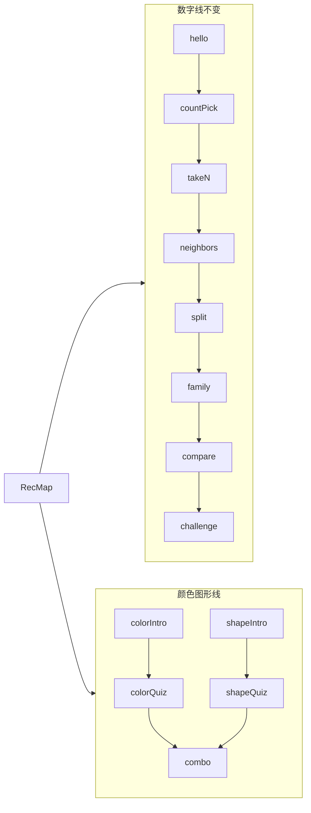

# 数感岛 · 认一认 · 颜色 / 图形（设计）

> **状态**：设计已确认，待实现  
> **关联**：[数感岛-一期-design.md](./数感岛-一期-design.md)、[数感岛-比一比-design.md](./数感岛-比一比-design.md)  
> **入口**：认一认地图 `/sense/recognize`（数字关旁新增颜色·图形分区）  
> **进度键**：`kiddo-playlearn:number:recognize-attr:v1`（与数字线 `recognize:v1` 隔离）

---

## 0. 一句话与范围

| 项 | 内容 |
| --- | --- |
| 定位 | 帮 **4～7 岁**建立颜色名、常见图形名，以及「颜色 + 图形」组合指认 |
| **本期** | 颜色来报到、认颜色、图形来报到、认图形、颜色图形组合 |
| **不做（首版）** | 听名点图、描形、拼图形、超过词表外的颜色/立体图形、倒计时/扣分 |
| 底线 | 仅点击 / 滑卡；错题友好；无红色大叉、倒计时、扣分、排行榜 |
| 实现路径 | **扩展 RecPlay + RecMap**（方案 1），不新建独立 Play 路由树 |

---

## 1. 已锁定决策

| 项 | 决定 |
| --- | --- |
| 预习形态 | **单独成关**：颜色来报到 / 图形来报到（滑卡学名） |
| 范围 | 预习×2 + 认颜色 + 认图形 + 组合，首版一次齐 |
| 词表 | **12 色 + 8 形**（含易混） |
| 地图解锁 | **两路汇合**：颜色线 ‖ 图形线，两边都通后开组合 |
| 挂载 | **并进现有认一认地图**（数字关之后/旁边加分区） |
| 答题 | **看图点名**（出示色块/图形，点文字按钮） |
| 与数字进度 | **完全独立**，进认一认即可开两个「来报到」 |
| 图形预习 | 与颜色对称，单独「图形来报到」 |

---

## 2. 词表

### 2.1 颜色（12）

红、橙、黄、绿、青、蓝、紫、粉、棕、灰、黑、白

易混对（出题优先塞干扰）：红↔橙、蓝↔青、紫↔粉、灰↔黑、黄↔橙

### 2.2 图形（8）

圆、椭圆、正方形、长方形、三角形、菱形、梯形、五角星

易混对：圆↔椭圆、正方形↔长方形、三角形↔菱形 等

---

## 3. 地图与解锁

```text
[颜色来报到] ──► [认颜色] ──┐
                              ├──► [颜色图形组合]
[图形来报到] ──► [认图形] ──┘
```

- 进认一认即可点两个「来报到」（不依赖数字线 `REC_UNLOCK_ORDER`）
- 「认颜色」仅当「颜色来报到」通关；「认图形」同理
- 「组合」需「认颜色」且「认图形」都通关
- 两线可并行；现有数字关节点与线性解锁 **不变**



---

## 4. 玩法交互

### 4.1 预习关（colorIntro / shapeIntro）

- 全屏大卡，左右滑或点「下一张」翻完词表（颜色 12 / 图形 8）
- 每张：大视觉（纯色块 / 线框填色图形）+ 名称大字 + 语音读名
- 翻完最后一张 → Celebrate → 记通关 → 回地图解锁对应「认×」
- 中途退出不记通关；再进从第一张重来

### 4.2 认颜色 / 认图形（colorQuiz / shapeQuiz）

- 上方：目标色块，或中性填色的线框图形（认图形避免颜色干扰）
- 下方：约 4 个文字按钮
- 对：短反馈 + 下一题；错：轻提示可再点，不立刻收窄到只剩正确答案
- 干扰项优先易混对
- 每关约 **8～10 题** 通关

### 4.3 组合关（combo）

- 上方：带色图形（如红三角形）
- 下方：文字「红三角形」等；干扰：同色异形 / 同形异色 / 易混色同形
- 题量约 **8～10**

### 4.4 共用

- SenseChrome、Web Speech、Celebrate、写进度（与认数字手感一致）

---

## 5. 技术落点

### 5.1 Mode 与进度

现有认数字是一条链（`REC_UNLOCK_ORDER`）。颜色/图形是两路汇合且与数字无关，**不能**简单追加进 `REC_MODES` 线性解锁。

| 项 | 约定 |
| --- | --- |
| `AttrModeId` | `colorIntro` \| `colorQuiz` \| `shapeIntro` \| `shapeQuiz` \| `combo` |
| 元数据 | `ATTR_MODES`（`meta.ts`），**不改** `REC_MODES` 顺序 |
| 进度键 | `kiddo-playlearn:number:recognize-attr:v1` |
| 解锁 | `useSenseProgress`：两 intro 默认可进；quiz 看对应 intro；combo 看两 quiz |

### 5.2 路由与文件

| 文件 | 改动 |
| --- | --- |
| [`src/data/sense/attr.ts`](../../src/data/sense/attr.ts) | **新建**：颜色/图形词表、易混、出题工具 |
| [`src/data/sense/meta.ts`](../../src/data/sense/meta.ts) | 增加 `AttrModeId` / `ATTR_MODES` |
| [`src/composables/useSenseProgress.ts`](../../src/composables/useSenseProgress.ts) | attr 进度读写与解锁 |
| [`src/views/sense/RecMap.vue`](../../src/views/sense/RecMap.vue) | 「颜色 · 图形」分区 + 锁态 |
| [`src/views/sense/RecPlay.vue`](../../src/views/sense/RecPlay.vue) | 五个 mode 分支：预习滑卡 + 看图点名 |
| 路由 | 优先沿用 `/sense/recognize/:mode`，放宽允许 `AttrModeId` |
| 可选 | `ColorSwatch.vue` / `ShapeGlyph.vue`（RecPlay 过长再拆） |

### 5.3 边界

- **不改** 框架级配置；数字线玩法与 `REC_UNLOCK_ORDER` 行为保持原样
- 认颜色 ≠ 比一比（量的比较）；≠ 认一认·比多少（求差）

---

## 6. 验收清单（实现后）

- [ ] 认一认地图可见颜色·图形分区；数字线锁态不受影响
- [ ] 两「来报到」可直接进；对应「认×」未预习前锁定
- [ ] 两边「认×」都通后组合解锁；只通一边时组合仍锁
- [ ] 预习翻完记星；中途退出不记通关
- [ ] 认颜色/认图形/组合：看图点名，易混干扰可见
- [ ] 语音可读名；通关 Celebrate 回地图

---

## 7. 明确不做

听名点图双向混关、描边、立体几何、超出词表的颜色名、独立「颜色图形」岛入口（首版挂认一认即可）。
